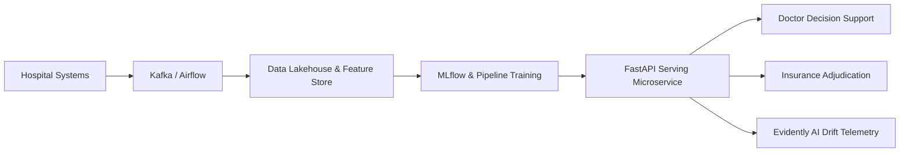

# HealthConnect Rwanda — Production Machine Learning Deployment Architecture

**Author:** Zaid Harboul  
**Role:** Senior Machine Learning Engineer & MLOps Specialist  
**Project:** HealthConnect Rwanda — Healthcare Analytics & Artificial Intelligence Transformation  
**Track:** Machine Learning Engineering | AnalystLab Africa — Week 6  

---

## 1. Executive Architecture Overview

The HealthConnect Rwanda Machine Learning Deployment Architecture establishes an enterprise-grade, privacy-preserving, fault-tolerant infrastructure designed to serve clinical risk scoring, patient satisfaction estimation, automated insurance adjudication, and revenue forecasting across Rwanda's healthcare facilities.

The architecture bridges transactional Hospital Information Systems (OpenMRS, proprietary HIS) with predictive machine learning microservices while enforcing the **Rwanda Law No. 058/2021 on Personal Data Protection and Privacy**.

---

## 2. Comprehensive System Architecture Layers

### 2.1 Layer 1: Healthcare Information Systems (HIS) & Source Data
- **Electronic Health Records (EHR)**: OpenMRS deployed across district hospitals capturing encounters, appointments, and vitals.
- **Laboratory Information Systems (LIS)**: Records diagnostic investigations and test results.
- **Billing & Revenue Portals**: Financial charge-capture systems and Rwanda Social Security Board (RSSB) insurance portals.
- **Data Ingestion**: Apache Kafka streaming bus for real-time transaction ingestion and scheduled Airflow DAGs for overnight batch reconciliation.

### 2.2 Layer 2: Ingestion & Data Protection Gateway
- **Schema Validation**: Automated contract checking via Great Expectations against the canonical 27-table relational schema.
- **Data De-Identification Gateway**: Automatic masking and hashing of primary direct identifiers (Names, National IDs, Phone Numbers) using SHA-256 with rotating salts before data enters the analytical lakehouse.

### 2.3 Layer 3: Feature Store & Processing Engine
- **Lakehouse Storage**: Delta Lake on object storage partitioned by `FacilityID` and `EncounterDate`.
- **Feature Store (Feast)**:
  - *Entity*: Patient, Facility, Department.
  - *Real-time features*: PatientToDoctorRatio, DepartmentWorkload, RecentAppointmentCount.
  - *Batch features*: ChronicConditionStatus, TotalHistoricalBilled, AverageFacilitySatisfaction.

### 2.4 Layer 4: MLOps, Versioning & Model Lifecycle
- **Experiment Tracking**: MLflow tracking hyperparameters, cross-validation metrics, confusion matrices, and ROC curves.
- **Model Registry**: Staged promotion pipeline (`Draft` -> `Staging` -> `Production`) with automated regression tests before deployment approval.
- **Reproducibility**: Models packaged as scikit-learn Pipelines containing both feature transformers and estimators to prevent train-serve skew.

### 2.5 Layer 5: Model Serving & Microservice API
- **Containerized Serving**: FastAPI application packaged within a lightweight Docker container (`python:3.12-slim`).
- **Orchestration**: Kubernetes (K8s) deployment with horizontal pod autoscaling (HPA) targeting 70% CPU utilization.
- **Response Caching**: Redis cache for recurring facility metrics and claims queries, achieving sub-20ms inference latency.

### 2.6 Layer 6: Healthcare Workflow Integration
- **Clinical Decision Support (CDS)**: Integrated into doctor consultation screens via SMART-on-FHIR / REST API. Triage predictions are displayed alongside confidence scores and top SHAP feature drivers.
- **Billing & Insurance Queue**: Automated pre-adjudication routing high-confidence claims directly to payment clearance while flagging discrepancies (>1.05 ratio) for administrative review.
- **Executive Power BI Dashboards**: Near-real-time streaming datasets for hospital directors and the Ministry of Health.

### 2.7 Layer 7: Governance, Drift Monitoring & Human-in-the-Loop
- **Data & Model Drift Telemetry**: Evidently AI running daily drift checks comparing live inference distributions against training baselines (Kolmogorov-Smirnov and PSI tests).
- **Automated Alerts**: Alerts dispatched via Slack/Email if data drift exceeds 0.15 PSI or serving latency exceeds 250ms.
- **Clinical Governance Committee**: Multi-disciplinary oversight board (Chief Medical Officer, Lead MLE, Data Privacy Officer) reviewing monthly model performance and audit logs. Autonomous medical treatment decisions are strictly disallowed.

---

## 3. High-Level Mermaid Architecture Diagram

See [architecture_diagram.mmd](file:///deployment/architecture_diagram.mmd) for the complete flowchart.

---

## 4. Security, Access Control & Compliance

1. **Role-Based Access Control (RBAC)**: Enforced via OAuth2 with JWT tokens. Clinicians, administrators, and auditors operate under strict principle-of-least-privilege.
2. **Encryption Standards**: AES-256 encryption at rest; TLS 1.3 encryption in transit for all API traffic.
3. **Audit Trail**: Immutable append-only audit logging recording every prediction request, user token, timestamp, and model version. Real patient identities are never logged in plain text.
