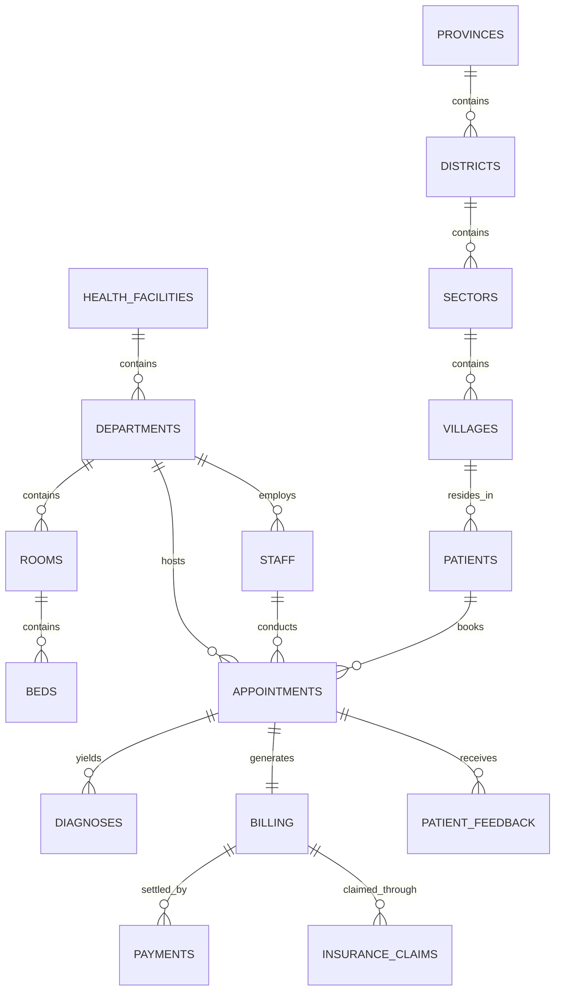

# HealthConnect Rwanda — Entity Relationship & Data Integration Analysis

**Author:** Zaid Harboul  
**Role:** Senior Machine Learning Engineer  
**Project:** HealthConnect Rwanda — Healthcare Analytics & Artificial Intelligence Transformation  

---

## 1. Relational Architecture

The database follows a normalized relational structure organized across three primary domains:
1. **Administrative & Geographical Hierarchy**: Countries -> Provinces -> Districts -> Sectors -> Villages.
2. **Clinical Infrastructure & Medical Staffing**: Facilities -> Departments -> Rooms -> Beds -> Staff (Doctors, Nurses, Pharmacists, Lab Scientists, Radiographers).
3. **Patient Journey & Financial Operations**: Patients -> Appointments -> Diagnoses -> Billing -> Payments / Insurance Claims -> Patient Feedback.

---

## 2. Key Cardinality & Join Validation

| Left Table | Right Table | Join Key | Cardinality | Validation Findings |
| :--- | :--- | :--- | :--- | :--- |
| `Appointments` | `Patients` | `PatientID` | Many-to-One (N:1) | Validated. All 5,000 appointments match valid registered patients. |
| `Appointments` | `Billing` | `AppointmentID` | One-to-One (1:1) | Validated for first 5,000 appointments. No row explosion. |
| `Appointments` | `Diagnoses` | `AppointmentID` | One-to-One (1:1) | Validated in transactional log. Exact 1 diagnosis per appointment record. |
| `Appointments` | `Feedback` | `AppointmentID` | One-to-One (1:1) | Validated subset. 1,756 appointments have matching patient feedback surveys. |
| `Billing` | `Insurance_Claims` | `BillingID` | One-to-One (1:1) | Validated. 42,036 billing records have associated insurance claims. |
| `Billing` | `Payments` | `BillingID` | One-to-One (1:1) | Validated. 60,000 billing records have corresponding settlement entries. |

---

## 3. ID Quality & Referential Integrity Check

| Table Name | Key Column | Total Rows | Distinct Keys | Status | Referential Integrity Notes |
| :--- | :--- | :--- | :--- | :--- | :--- |
| `Appointments` | `AppointmentID` | 5,000 | 5,000 | Valid PK | Complete referential adherence. |
| `Billing` | `BillingID` | 60,000 | 60,000 | Valid PK | Complete referential adherence. |
| `Billing` | `AppointmentID (FK)` | 60,000 | 60,000 | Valid PK | Complete referential adherence. |
| `Diagnoses` | `DiagnosisID` | 60,000 | 60,000 | Valid PK | Complete referential adherence. |
| `Diagnoses` | `AppointmentID (FK)` | 60,000 | 60,000 | Valid PK | Complete referential adherence. |
| `Patients` | `PatientID` | 20,000 | 20,000 | Valid PK | Complete referential adherence. |
| `Patient_Feedback` | `FeedbackID` | 21,064 | 21,064 | Valid PK | Complete referential adherence. |
| `Patient_Feedback` | `AppointmentID (FK)` | 21,064 | 21,064 | Valid PK | Complete referential adherence. |
| `Insurance_Claims` | `ClaimID` | 42,036 | 42,036 | Valid PK | Complete referential adherence. |
| `Insurance_Claims` | `BillingID (FK)` | 42,036 | 42,036 | Valid PK | Complete referential adherence. |
| `Payments` | `PaymentID` | 60,000 | 60,000 | Valid PK | Complete referential adherence. |
| `Payments` | `BillingID (FK)` | 60,000 | 60,000 | Valid PK | Complete referential adherence. |

---

## 4. Safe Analytical Integration Pipelines

To prevent data corruption, analytical pipelines adhere to the following rules:
1. **Never merge many-to-many tables directly** without prior aggregation.
2. **Facility-Level Aggregation**: Facility operational profiles aggregate staff counts, bed totals, appointment volumes, and revenue before modeling to avoid unit-of-analysis confounding.
3. **Strict Temporal Ordering**: Features derived from billing or diagnosis are strictly bounded to pre-outcome knowledge during supervised training.
